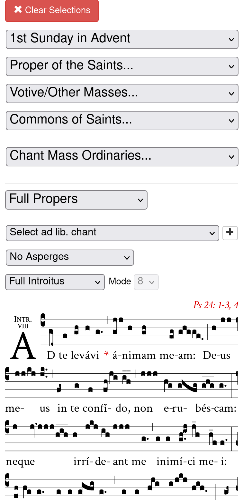
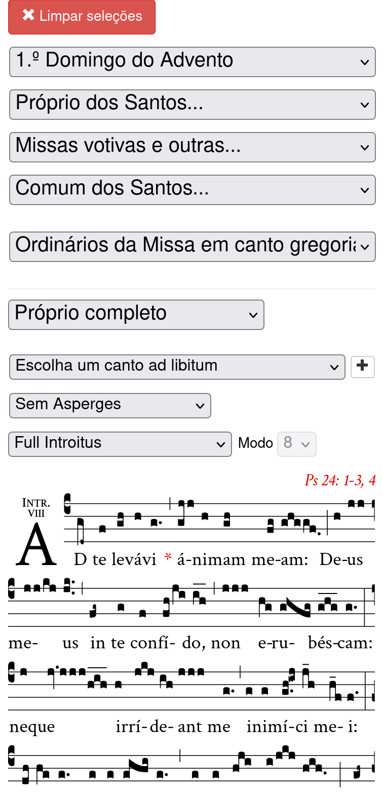

  

<h1 align="center">Cantemus</h1>

  <b>The Gregorian propers of the Mass for your choir, on your phone or in your browser.</b> 
  🇧🇷 <a href="#pt"><b>Versão em português ↓</b></a>

  <a href="https://github.com/hangueth/jgabc/releases/latest"><b>⬇️ Download for Android</b></a>
  &nbsp;·&nbsp;
  <a href="https://hangueth.github.io/jgabc/propers.html"><b>🌐 Open in your browser</b></a>

  

## What is Cantemus?

Cantemus is a fork of [Chant Tools](https://github.com/bbloomf/jgabc), the app by Benjamin Bloomfield
that shows the chants of the Mass (Introit, Gradual, Alleluia, Offertory, Communion and the
ordinary) for any day of the year, in Gregorian notation, ready to sing, print or play.

Cantemus is **not a competing app**: it is a lab. New ideas are tried with a real choir first, and
the ones that work well are offered to Chant Tools. The **+** button (more than one chant in an ad
libitum slot) started here and is now part of Chant Tools 1.19.0.

## What's different from Chant Tools

- **My chants:** add any chant from [GregoBase](https://gregobase.selapa.net/) to the ad libitum
  menus. Choose **"+ Add a chant from GregoBase…"** at the top of an ad libitum menu and paste the
  chant's link or number; the **(i)** button explains how to find it. Your chants appear in
  alphabetical order among the others, marked with `*`, and also work offline.
- **Share a repertoire:** export your chants to a `.mychants` file, as a backup or to send to the
  rest of the choir. Opening the file on another phone adds the chants there.
- **Portuguese (Brazil):** menus, rubrics, names of the days, the Novus Ordo calendar and the
  dialogs in Portuguese, with an option to keep the names of the days in Latin. The Latin of the
  chants never changes.
- **Its own icon**, and it installs alongside Chant Tools: you can have both.
- Works on Android 7.0 too.

## Installing on Android

1. Open the [latest release](https://github.com/hangueth/jgabc/releases/latest) on your phone and
   download the `Cantemus-….apk` file.
2. Open the downloaded file. Android may ask you to allow installing apps from your browser or
   file manager: allow it.
3. Tap **Install**. To update later, download the new version and install it the same way, over
   the old one; your chants are kept.

No phone? Everything also works in the [browser](https://hangueth.github.io/jgabc/propers.html).

## Choosing the language

Next to the dark mode button there is a language menu: **English**, **Português** or
**Português (dias em latim)**. Without a choice, Cantemus follows the language of your device.

## Credits and license

- [Chant Tools](https://github.com/bbloomf/jgabc) by Benjamin Bloomfield: almost all of what you
  see is his work.
- The chants added with My chants come from [GregoBase](https://gregobase.selapa.net/).
- Like Chant Tools, Cantemus is in the public domain ([The Unlicense](LICENSE)).

## For developers

The site is plain HTML and JavaScript: serve the folder (for example,
`python3 -m http.server 8765`) and open `http://127.0.0.1:8765/propers.html`. The tests run with
`npx -y bun test`. The `master` branch mirrors Chant Tools; Cantemus lives in the `cantemus`
branch, and the Android app in `cantemus-app`. How each feature works, in Portuguese:
[docs/CANTEMUS.md](docs/CANTEMUS.md).

---

<h1 align="center">Cantemus (em português)</h1>

  <b>Os próprios gregorianos da Missa para o seu coro, no celular ou no navegador.</b> 
  🇺🇸 <a href="#en"><b>English version ↑</b></a>

  <a href="https://github.com/hangueth/jgabc/releases/latest"><b>⬇️ Baixar para Android</b></a>
  &nbsp;·&nbsp;
  <a href="https://hangueth.github.io/jgabc/propers.html"><b>🌐 Abrir no navegador</b></a>

  

## O que é o Cantemus?

O Cantemus é um fork do [Chant Tools](https://github.com/bbloomf/jgabc), o aplicativo de Benjamin
Bloomfield que mostra os cantos da Missa (Intróito, Gradual, Aleluia, Ofertório, Comunhão e o
ordinário) de qualquer dia do ano, em notação gregoriana, prontos para cantar, imprimir ou ouvir.

O Cantemus **não é um aplicativo concorrente**: é um laboratório. As ideias novas são testadas
primeiro com um coro de verdade, e as que funcionam bem são oferecidas ao Chant Tools. O botão
**+** (mais de um canto num mesmo ad libitum) nasceu aqui e hoje faz parte do Chant Tools 1.19.0.

## O que muda em relação ao Chant Tools

- **Meus cantos (My chants):** qualquer canto do [GregoBase](https://gregobase.selapa.net/) pode
  ser adicionado aos menus ad libitum. Escolha **"+ Adicionar um canto do GregoBase…"** no alto de
  um menu ad libitum e cole o link ou o número do canto; o botão **(i)** explica como encontrá-lo.
  Os seus cantos aparecem em ordem alfabética entre os demais, marcados com `*`, e funcionam também
  sem internet.
- **Compartilhar um repertório:** exporte os seus cantos para um arquivo `.mychants`, como cópia de
  segurança ou para mandar ao resto do coro. Ao abrir o arquivo em outro celular, os cantos são
  adicionados lá.
- **Português:** menus, rubricas, nomes dos dias, calendário do Novus Ordo e as janelas em
  português, com a opção de manter os nomes dos dias em latim. O latim dos cantos nunca muda.
- **Ícone próprio**, e instala ao lado do Chant Tools: dá para ter os dois.
- Funciona também no Android 7.0.

## Como instalar no Android

1. Abra a [versão mais recente](https://github.com/hangueth/jgabc/releases/latest) no celular e
   baixe o arquivo `Cantemus-….apk`.
2. Abra o arquivo baixado. O Android pode pedir permissão para instalar aplicativos pelo navegador
   ou pelo gerenciador de arquivos: permita.
3. Toque em **Instalar**. Para atualizar depois, baixe a versão nova e instale do mesmo jeito, por
   cima da antiga; os seus cantos continuam lá.

Sem celular Android? Tudo funciona também no [navegador](https://hangueth.github.io/jgabc/propers.html).

## Como escolher o idioma

Ao lado do botão do modo escuro há um menu de idioma: **English**, **Português** ou
**Português (dias em latim)**. Sem escolha, o Cantemus segue o idioma do aparelho.

## Créditos e licença

- [Chant Tools](https://github.com/bbloomf/jgabc), de Benjamin Bloomfield: quase tudo o que você vê
  é trabalho dele.
- Os cantos adicionados pelo Meus cantos vêm do [GregoBase](https://gregobase.selapa.net/).
- Como o Chant Tools, o Cantemus é de domínio público ([The Unlicense](LICENSE)).

## Para programadores

O site é HTML e JavaScript puros: sirva a pasta (por exemplo, `python3 -m http.server 8765`) e
abra `http://127.0.0.1:8765/propers.html`. Os testes rodam com `npx -y bun test`. O branch
`master` espelha o Chant Tools; o Cantemus fica no branch `cantemus`, e o aplicativo Android no
`cantemus-app`. Como cada funcionalidade funciona por dentro:
[docs/CANTEMUS.md](docs/CANTEMUS.md).
