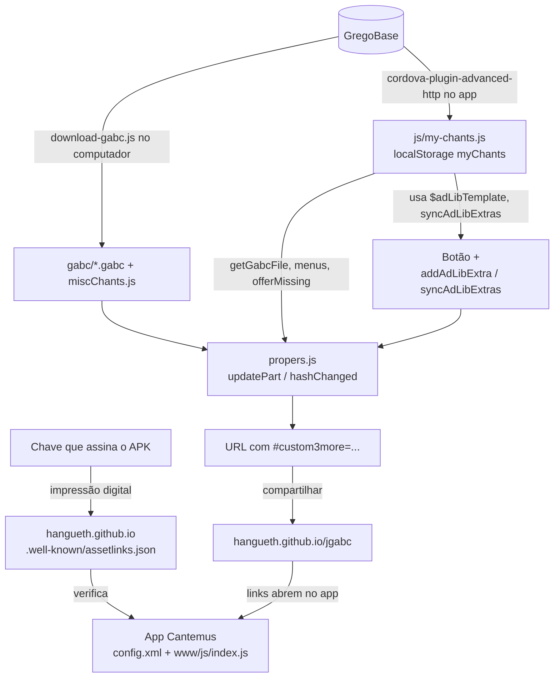

# Cantemus: documentação técnica

O **Cantemus** é uma versão modificada (um *fork*) do **Chant Tools** de Benjamin Bloomfield
(<https://github.com/bbloomf/jgabc>), feita para as necessidades de um coral: mais cantos
ad libitum, vários cantos no mesmo momento da Missa e uma biblioteca pessoal de cantos do
GregoBase.

Este documento explica **o que foi mudado, onde fica cada coisa, como as peças se ligam e
do que cada uma depende**. Para o histórico de trabalho e os próximos passos, veja o diário
de bordo (`DIARIO-DE-BORDO.md`, na pasta do projeto, fora do repositório).

> **Como ler esta documentação:** cada funcionalidade tem as mesmas seções: *o que faz*
> (para quem usa), *como funciona* (para quem mantém o código), *arquivos*, *dependências*
> e *limitações*. Nomes de funções aparecem em `código`. Procure-os no arquivo com Ctrl+F;
> os números de linha mudam a cada edição, os nomes não.

---

## Sumário

1. [Visão geral do projeto](#1-visão-geral-do-projeto)
2. [Como o Chant Tools funciona por dentro](#2-como-o-chant-tools-funciona-por-dentro)
3. [Funcionalidade: cantos ad libitum adicionados](#3-funcionalidade-cantos-ad-libitum-adicionados)
4. [Funcionalidade: vários cantos por ad libitum (botão +)](#4-funcionalidade-vários-cantos-por-ad-libitum-botão-)
5. [Funcionalidade: My chants (biblioteca pessoal)](#5-funcionalidade-my-chants-biblioteca-pessoal)
6. [Funcionalidade: endereço próprio e links do app](#6-funcionalidade-endereço-próprio-e-links-do-app)
7. [Funcionalidade: identidade do app (Cantemus)](#7-funcionalidade-identidade-do-app-cantemus)
8. [Mapa de dependências](#8-mapa-de-dependências)
9. [Ambiente e comandos](#9-ambiente-e-comandos)
10. [Como trazer as atualizações do Benjamin](#10-como-trazer-as-atualizações-do-benjamin)
11. [Cuidados e armadilhas conhecidas](#11-cuidados-e-armadilhas-conhecidas)

---

## 1. Visão geral do projeto

### Repositórios e sites

| O quê | Onde | Para quê |
|---|---|---|
| Original do Benjamin | `github.com/bbloomf/jgabc` (remoto `upstream`) | Fonte das atualizações oficiais |
| Fork do Cantemus | `github.com/hangueth/jgabc` (remoto `origin`) | Nosso código |
| Site do Cantemus | <https://hangueth.github.io/jgabc/propers.html> | Versão web, publicada pelo GitHub Pages a partir do branch `cantemus` |
| Raiz do domínio | `github.com/hangueth/hangueth.github.io` | Só o `.well-known/assetlinks.json` (verificação dos links no Android) e um redirecionamento |

### Branches (ramos do código)

```
upstream/master ─────────────┬──────────────► (atualizações do Benjamin)
                             │
                 multiple-ad-libitum           ← só o botão +; aceito pelo Benjamin (PR #127,
                             │                    Chant Tools 1.19.0)
                             ▼
                          cantemus             ← versão web do Cantemus: tudo o que é nosso
                             │                    (publicada em hangueth.github.io/jgabc)
                             ▼ (merge)
upstream/cordova ──► cantemus-app             ← o app Android (pasta jgabc-cordova)
```

- **`master`**: cópia do original, sem mudanças nossas.
- **`multiple-ad-libitum`**: só a funcionalidade do botão **+**. Ficou separada para virar um
  *pull request* sem levar o resto; o Benjamin a incorporou (PR #127) e ela já está no
  `upstream/master`, então este branch não precisa mais de manutenção.
- **`cantemus`**: a versão web completa do Cantemus (cantos, botão +, My chants, links próprios).
- **`cantemus-app`**: o app. Nasce do branch `cordova` do Benjamin e recebe o `cantemus` por merge.

### Pastas no computador

```
Cantemus/
├── jgabc/            ← checkout principal (branches master, multiple-ad-libitum, cantemus)
├── jgabc-cordova/    ← "worktree" do mesmo repositório, no branch cantemus-app (o app)
├── Partituras/       ← PDFs e imagens de partituras enviadas para identificar
├── Cantemus-*.apk    ← APKs gerados para teste
├── DIARIO-DE-BORDO.md
└── CLAUDE.md         ← orientações para o Claude nas próximas sessões
```

> **Worktree** é uma segunda pasta ligada ao mesmo repositório Git, com outro branch aberto.
> Assim a versão web e o app ficam abertos ao mesmo tempo, sem trocar de branch.

---

## 2. Como o Chant Tools funciona por dentro

É preciso entender estas peças do original para entender as nossas mudanças.

### 2.1. Páginas e scripts

- O app é um **site estático**: HTML, CSS e JavaScript com jQuery, sem framework e sem servidor.
- A página principal para nós é a **Propers Tool** (`propers.html` + `propers.js`). Ela monta a
  Missa: próprios, ordinário e os **ad libitum**.
- As partituras são desenhadas pela biblioteca **Exsurge** (`exsurge.min.js`, compilada,
  não editamos).
- **Partituras** são arquivos **GABC** (formato de texto do projeto Gregorio) em `gabc/<id>.gabc`,
  em que `<id>` é o **ID do canto no GregoBase** (<https://gregobase.selapa.net>).

### 2.2. Os ad libitum no original

- `propers.html` tem **um** bloco modelo `#divCustom` (part `custom`).
- Na inicialização, `propers.js` clona esse modelo para criar **quatro** ad libitum:
  `custom1` (início), `custom2` (após o Ofertório), `custom3` (após a Comunhão) e
  `custom4` (após o Ite).
- O menu de cada um é preenchido com `miscChants` (arquivo `miscChants.js`).
- Escolher um canto chama `updatePart(part)`, que baixa `gabc/<id>.gabc` e desenha a partitura.

### 2.3. O estado fica na URL

Tudo o que se escolhe vai para o "hash" da URL (a parte depois do `#`). Exemplo:

```
propers.html#sunday=Adv1#custom3=2014
```

- `addToHash()` grava; `hashChanged()` lê e reaplica (ao abrir o link, voltar etc.).
- Por isso **um link compartilhado reproduz a Missa inteira**. As nossas funcionalidades seguem
  a mesma regra.

### 2.4. De onde vêm as partituras: `download-gabc.js`

Script **Node.js** (roda no computador, não no app) que:

1. baixa do GregoBase todos os IDs listados (`ids` para os próprios e `miscChantIDs` para os
   ad libitum);
2. **limpa o latim** (`gabc-latin-normalization.js`, `gabc-latin-syllables.js`,
   `gabc-latin-accents.js`): acentos, sílabas, "æ" etc.;
3. grava `gabc/<id>.gabc` e **gera** `miscChants.js`, `texts.js`, `incipits.js` e `gabc-files.html`.

> `miscChants.js` **é gerado**. Para mudar o menu, mude o `download-gabc.js` e rode o script.

### 2.5. O app Android (Cordova)

- O app é o mesmo site, embrulhado pelo **Cordova** (um navegador dentro de um app nativo).
- No branch `cordova` do Benjamin, o site fica em `www/`; `config.xml` descreve o app; os
  plugins nativos ficam em `package.json`.
- `www/js/index.js` só existe no app: recebe os links abertos no Android (`handleUrl`) e
  restaura a última Missa ao reabrir o app (`onResume`, via `localStorage.savedHash`).
- `www/propers.js` do app tem **uma diferença** em relação ao do site: o botão de compartilhar
  copia o link quando o celular não oferece o menu de compartilhamento.

---

## 3. Funcionalidade: cantos ad libitum adicionados

> **Removidos em 2026-11-22.** Com o My chants (seção 5), o usuário passou a adicionar esses
> cantos pelo próprio app, e o Cantemus voltou a ter exatamente a lista oficial do Benjamin
> (os 3 commits foram revertidos; `miscChantNames` também saiu). Links antigos com esses IDs
> oferecem "Add to My chants". A seção fica como registro e como receita, caso um dia seja
> preciso acrescentar um canto oficial.

### O que fazia
Acrescentava cantos à lista ad libitum oficial (o mesmo menu dos que já existiam).

### Cantos que foram adicionados (hoje: adicionar pelo My chants, com estes IDs)

| Canto | GregoBase | Fonte / versão | Observação |
|---|---|---|---|
| Media vita | 3973 | Cantus selecti, 1957 (Solesmes) | Responsório, modo 4 |
| Miserere mei Deus (cantus prior) | 14256 | Puellae Charitatis | Salmo 50 completo (22 versículos) |
| Venite populi | 3351 | Cantus selecti, 1957 (Solesmes) | |
| Gaude Joseph | 15251 | | Modo 5 |
| Jesu corona Virginum | 7253 | Antiphonale Monasticum, 1934 | Hino, modo 8 |
| Audi benigne Conditor (monastic) | 9732 | Antiphonale Monasticum, 1934 | Diferente do 1830 (Liber Usualis), que já existia |
| Salve festa dies | 8241 | Cantus selecti, 1957 / Liber antiphonarius | Versão da Páscoa (não a 8716, de Corpus Christi) |

### Como funciona
1. O ID entra no fim da lista `miscChantIDs` em `download-gabc.js`.
2. Se o nome do GregoBase não serve (por exemplo, dois cantos com o mesmo nome), o nome do menu
   ia em **`miscChantNames`** (mapa `ID → nome`), que tínhamos criado no `download-gabc.js`
   e que saiu com a reversão; recriar se for preciso. Ele mudava só o nome no menu; o cabeçalho do arquivo `.gabc` continua com o nome original.
3. Rodar `node download-gabc.js` baixa tudo de novo e regenera os arquivos (seção 2.4).

### Arquivos
`download-gabc.js` (listas), `gabc/<id>.gabc` (gerados), `miscChants.js`, `texts.js`,
`incipits.js`, `gabc-files.html` (gerados).

### Dependências
GregoBase no ar; Node.js; `npm install` feito na pasta `jgabc`.

### Como identificar um canto a partir de uma partitura
1. Pelas primeiras palavras, procurar no índice do GregoBase (`incipit.php?letter=X`).
2. Baixar o GABC de cada versão candidata
   (`download.php?format=gabc&elem=1&id=<id>`) e comparar modo, clave, barras e as primeiras
   neumas com a imagem.
3. Conferir o texto completo (versículos, doxologia).
4. Arquivos baixados do GregoBase já trazem no nome o tipo, o canto e a versão
   (ex.: `va--venite_populi--solesmes_1957.pdf`).

### Limitações
- Rodar o script baixa **todos** os ~1.750 cantos (alguns minutos) e pode trazer correções
  que o GregoBase tenha feito em cantos antigos. Confira o `git diff` antes do commit.

---

## 4. Funcionalidade: vários cantos por ad libitum (botão +)

**Branch:** `multiple-ad-libitum` (e incluída em `cantemus`). **Status:** **aceita.** Oferecida
na issue <https://github.com/bbloomf/jgabc/issues/126>; o Benjamin abriu o PR
<https://github.com/bbloomf/jgabc/pull/127> com os nossos dois commits (autoria `hangueth`),
juntou em 2026-11-21 e lançou no **Chant Tools 1.19.0**. Agora é código do Benjamin: mudanças
nele devem ser propostas a ele.

### O que faz
- Cada um dos 4 ad libitum ganha um botão **+**. Cada clique acrescenta mais um canto logo
  abaixo (depois dos extras que já existirem ali).
- Os extras têm um **×** para removê-los.
- Os extras entram no PDF e no menu "Include in PDF", na ordem da página.
- Tudo fica no link: abrir ou compartilhar a URL reproduz os extras.
- "Clear selections" remove os extras.

### Como funciona

**Nomes das partes.** Os 4 originais são `custom1`…`custom4`. Os extras recebem `custom5`,
`custom6`… (um contador, `nextAdLibIndex`), não importa onde estejam. Cada extra guarda o
**grupo** (o ad libitum ao qual pertence) no atributo `ad-lib-group`.

> Os nomes precisam terminar em número (`custom7`, e não `custom3b`), porque o código original
> descobre a parte pelo id do elemento com a expressão `/[A-Z][a-z]+\d*$/`.

**Formato na URL.** Os extras de cada grupo ficam numa chave só, em ordem:

```
#custom3=2014#custom3more=3973,3020,no
```

significa: no ad libitum da Comunhão (`custom3`), o canto 2014; depois dele, mais três: 3973,
3020 e um ainda sem canto (`no`).

**Funções** (em `propers.js`, logo depois do tratamento dos menus `[part^=custom] select`):

| Função | Papel |
|---|---|
| `$adLibTemplate` | Cópia "limpa" do bloco `#divCustom1`, feita antes de qualquer canto ser desenhado; é o molde dos extras |
| `addAdLibExtra(group, id)` | Cria um extra: clona o molde, renomeia ids, insere na página e no menu "Include in PDF", cria `sel[part]` e chama `updatePart` |
| `removeAdLibExtra(part)` | Remove o bloco, a entrada do PDF e o estado (`sel`, `selCustom`, `includePropers`) |
| `removeAllAdLibExtras()` | Usada por "Clear selections" |
| `getAdLibExtrasHash()` | Monta as chaves `custom<n>more` a partir da página |
| `syncAdLibExtras(hash)` | O caminho inverso: cria, remove e seleciona extras para bater com a URL. É chamada em `hashChanged()` |
| handler `change` em `[ad-lib-group] select` | Trata a troca de canto num extra (os originais têm o handler do Benjamin) |
| handlers `.btn-ad-lib-add` / `.btn-ad-lib-remove` | Os botões + e × |

**CSS:** `.child-main.ad-lib-menu` em `propers.css` mantém o botão na linha do menu
(o menu encolhe; importante no celular).

### Fluxo ao clicar em +

```
clique no + ─► addAdLibExtra(grupo) ─► bloco novo na página + entrada no "Include in PDF"
            └► addToHash(getAdLibExtrasHash()) ─► URL ganha custom<n>more=...
escolher canto no extra ─► handler change ─► updatePart(part) ─► baixa e desenha o GABC
abrir um link ─► hashChanged() ─► syncAdLibExtras(hash) ─► recria os extras
```

### Dependências (no código do Benjamin)
`updatePart`, `sel`, `selCustom`, `includePropers`, `makeChantContextForSel`, `addToHash`,
`hashChanged`, `updateQuickPdf`, `getPdfPartList` (lê os `[part]` em ordem de página) e
`clearSelections`. Se o Benjamin renomear qualquer um deles, esta funcionalidade precisa de ajuste.

### Limitações
- O **+** só existe nos 4 pontos originais; não dá para criar um ad libitum num lugar novo.
- Não dá para reordenar extras (só remover e adicionar de novo).

---

## 5. Funcionalidade: My chants (biblioteca pessoal)

**Branch:** `cantemus` (não oferecida ao Benjamin ainda).

### O que faz
- A segunda opção de cada menu ad libitum (logo abaixo de "Select ad lib. chant") é
  **"+ Add a chant from GregoBase…"**, no topo para ser vista. Ela abre uma janela em que se
  cola o **link ou o ID** do GregoBase (e, opcionalmente, um nome para o menu). O botão **(i)**
  ao lado do texto abre uma explicação: o que é o GregoBase (site gratuito, sem login) e como
  achar um canto e pegar o link ou o ID.
- No **app**, o canto é baixado e guardado **no aparelho**; aparece em todos os menus **no meio
  dos cantos oficiais, em ordem alfabética, com um `*` no fim do nome** (ex.: *Ave verum (teste) \**),
  e já fica selecionado. O `*` só aparece no menu; o nome guardado não muda. (Até 2026-11-21
  ficavam num grupo "My chants" separado; o usuário preferiu tudo junto.)
- Na **web**, o GregoBase bloqueia o download (veja *CORS* abaixo); a janela então pede para
  colar o GABC copiado da página do canto.
- A mesma janela lista os cantos da biblioteca, com uma lixeira para remover.
- **Exportar e importar:** abaixo da lista, **"Export My chants"** gera um arquivo
  `my-chants-AAAA-MM-DD.mychants` com todos os cantos (com as partituras). No app, abre o
  menu de compartilhar do Android (WhatsApp, Drive, e-mail…); na web, baixa o arquivo.
  **"Import a file"** escolhe um arquivo desses e acrescenta os cantos que faltam; os que já
  existem ficam como estão. Serve de backup e para passar a biblioteca aos coralistas.
- **Abrir o arquivo direto (app):** ao tocar num `.mychants` no WhatsApp, no Drive ou no app de
  arquivos, o Android oferece **"Abrir com Cantemus"**; o app mostra a janela **"Import My
  chants"** com os cantos do arquivo e o botão para acrescentá-los.
- **Nome neutro de propósito:** a extensão `.mychants` e o formato `"my-chants"` não citam o
  Cantemus, para que o Chant Tools possa usar os mesmos arquivos num eventual merge. Arquivos
  antigos (`.json`, formato `"cantemus-my-chants"`) continuam sendo aceitos.
- **Links compartilhados:** se a URL tiver cantos que o aparelho não tem (nem oficiais, nem na
  biblioteca), aparece o aviso **"Chants missing from this app"**, que baixa todos com um toque.

### Por que funciona com links compartilhados
Os cantos da biblioteca são guardados pelo **mesmo ID do GregoBase** que os cantos oficiais
usam. Então a URL não muda de formato (`#custom1=9085`), e se um dia o Benjamin oficializar o
mesmo canto, o link continua valendo.

### Como funciona

**Armazenamento.** `localStorage["myChants"]`, um JSON:

```json
{
  "9085": { "name": "Jesu corona Virginum (In Tempore Paschali)", "gabc": "name: ...\n%%\n(c4)...", "added": "2026-11-21T03:10:00.000Z" }
}
```

O `localStorage` é do aparelho/navegador: **sobrevive a atualizações do app** (que trocam só o
código), mas some se o app for desinstalado ou os dados do site forem apagados.

**Módulo `js/my-chants.js`** (objeto global `MyChants`, independente do `propers.js`):

| Função | Papel |
|---|---|
| `get(id)`, `list()`, `add(id, name, gabc)`, `remove(id)` | Biblioteca no `localStorage` |
| `onChange(f)` | Avisa quem precisa (os menus) quando a biblioteca muda |
| `parseId(texto)` | Aceita `3973`, `…chant.php?id=3973` ou o link de download |
| `download(id)` | Baixa o GABC: usa `cordova.plugin.http` se existir (app); senão tenta `fetch` (web, falha por CORS e marca o erro com `canPaste`) |
| `install(id, nome)` | `download` + `add`; o nome vem do cabeçalho `name:` do GABC |
| `checkGabc(texto)` | Valida o conteúdo; reconhece a resposta "Wrong id" do GregoBase |
| `showAddDialog(opções)` | A janela "Add a chant from GregoBase" (adicionar, colar GABC, listar, remover) |
| `offerMissing(ids, aoTerminar)` | A janela "Chants missing from this app" |
| `exportText()`, `exportFile()` | Monta o arquivo (`{format: "my-chants", version: 1, exported, chants}`, onde `chants` é o mesmo objeto do `localStorage`) e o entrega: `window.plugins.socialsharing` no app, download na web |
| `parseFile(texto)` | Confere o formato e cada canto (`checkGabc`); devolve `{chants, invalid}` |
| `importText(texto, isOfficial)` | Acrescenta os cantos novos do arquivo e devolve `{added, already, invalid}` |
| `showImportDialog(texto)` | A janela "Import My chants", para um arquivo aberto de outro app |

**Estilo:** `css/my-chants.css` (claro e escuro, este via `html.dark`).

**Ligação com `propers.js`** (o mínimo possível no código do Benjamin):

| Onde | O quê |
|---|---|
| `getAdLibMenuItems()` | Monta o menu: cantos oficiais com os da biblioteca encaixados em ordem alfabética (`localeCompare`, cada um antes do primeiro oficial que vem depois dele, para não mexer na ordem do Benjamin), com ` *` no nome; no topo, "+ Add a chant from GregoBase…" (valor `add-my-chant`) |
| `refreshAdLibMenus()` | Refaz todos os menus ad libitum (e o molde dos extras) quando a biblioteca muda, mantendo as escolhas |
| `openAddMyChant(select)` | Ao escolher "Add…": devolve o menu ao canto anterior e abre a janela; cada canto adicionado é selecionado ali |
| início dos handlers `change` dos ad libitum | Desviam o valor `add-my-chant` para `openAddMyChant` |
| `getGabcFile(path, part)` | Substitui o `$.get` em `updatePart`: se o ID está na biblioteca (e não é oficial), entrega o GABC guardado; se um ad libitum aponta para um canto que o aparelho não tem, mostra vazio em vez de dar erro |
| `isOfficialAdLibId(id)` | Se o ID está em `miscChants` |
| `offerMissingMyChants(hash)` | Chamada em `hashChanged()`: procura IDs da URL (`custom1`…`custom4` e `custom<n>more`) que faltam e chama `MyChants.offerMissing`; depois de instalar, reaplica a URL |

**Carregamento:** `propers.html` inclui `css/my-chants.css` e `js/my-chants.js` (antes de `propers.js`).

### CORS e o plugin nativo
- Navegadores só deixam uma página ler dados de outro site se esse site enviar o cabeçalho
  `Access-Control-Allow-Origin`. O GregoBase **não envia** (testado em 2026-11-20).
- No app, o plugin **`cordova-plugin-advanced-http`** faz a requisição pelo Android, fora do
  navegador, sem essa restrição. Ele só existe no branch `cantemus-app` (`package.json`).
- Se um dia o GregoBase liberar o CORS, a versão web passa a baixar sozinha, sem mudar nada.

### Android 7.0 e o certificado do GregoBase
- O GregoBase usa certificado da **Let's Encrypt**, cuja raiz (**ISRG Root X1**) só entrou no
  Android 7.1.1. No **Android 7.0** (o mínimo do app; é o caso do tablet do usuário), adicionar
  um canto falhava com *"Trust anchor for certification path not found"*.
- Correção (só `cantemus-app`): `res/android/xml/network_security_config.xml` acrescenta
  `res/android/raw/isrg_root_x1.pem` e `isrg_root_x2.pem` (copiados do pacote de certificados
  do Fedora; SHA-256 `96:BC:EC:06:…:08:C6` e `69:72:9B:8E:…:14:70`, válidos até 2035 e 2040)
  aos certificados do próprio aparelho; o `config.xml` liga isso com `resource-file` e
  `edit-config` (`android:networkSecurityConfig`). A pasta `res/` está no `.gitignore` do
  Benjamin: arquivos novos ali entram com `git add -f`.
- O plugin `cordova-plugin-advanced-http` só respeita essa configuração no modo **`legacy`**
  (o modo padrão lê direto o repositório de certificados do aparelho); o `js/my-chants.js`
  chama `setServerTrustMode('legacy')` antes do primeiro download.
- Testado num emulador Android 7.0 (`android7`): sem a correção, o erro do tablet; com ela, o
  canto baixa.

### Exportar no app: o plugin de compartilhar
- A WebView do app **ignora downloads**, por isso a exportação usa o
  **`cordova-plugin-x-socialsharing`** (6.0.4, só no branch `cantemus-app`): o arquivo vai como
  `df:nome.json;data:application/json;base64,…`; o plugin o grava no cache e abre o menu de
  compartilhar do Android. O Benjamin usou esse plugin até 2026 e o tirou quando passou a
  compartilhar links com `navigator.share`.
- A importação usa um `<input type="file">` comum, que o Cordova já abre no seletor de
  arquivos do Android.
- **Abrir `.mychants` de outros apps** (só `cantemus-app`): o `config.xml` tem dois
  `intent-filter` de `VIEW`: um para arquivos `application/json`, `application/octet-stream` e
  `application/x-mychants` (o WhatsApp e o Drive quase nunca passam a extensão), outro para
  qualquer tipo terminado em `.mychants` (gerenciadores de arquivos). Efeito colateral: o
  Cantemus aparece em "Abrir com" de outros JSON e arquivos genéricos; se não for uma
  biblioteca, a janela avisa. O `www/js/index.js` (`handleUrl` → `openMyChantsFile`) recebe a
  URI `content://` pelo `cordova-webintent`, lê com `resolveLocalFileSystemURL`
  (`cordova-plugin-file`) e chama `MyChants.showImportDialog`. Como a intent continua a mesma
  quando a página recarrega, a URI já mostrada fica em `sessionStorage.openedMyChantsFile`.
- Mudou o `config.xml`? Recrie a plataforma (`cordova platform rm android && cordova platform add android`).

### Dependências
GregoBase (`download.php`); `cordova-plugin-advanced-http` e `cordova-plugin-x-socialsharing` (app); `localStorage`; jQuery;
funções do Benjamin: `populate`, `mapNameToTitle`, `miscChants`, `updatePart`, `hashChanged`,
`lastHandledHash`, `selCustom`; e, da funcionalidade do botão +, `$adLibTemplate`, `adLibGroups`
e `syncAdLibExtras`. **My chants depende do botão +** (não funciona sem ele).

### Limitações
- Os cantos entram **sem a limpeza do latim** do `download-gabc.js` (ela só roda em Node).
  Aparecem bem, com pequenas diferenças de acentuação.
- Sem busca dentro do app: o usuário procura no site do GregoBase e cola o link.
- A biblioteca é **por aparelho**; para levá-la a outro, use exportar/importar.
- Importar **não substitui** um canto que já existe com o mesmo ID (nem o nome dado a ele).
- Só funciona em ad libitum (não nos próprios nem no ordinário).
- Os textos da interface estão em inglês, como o resto do app.

---

## 6. Funcionalidade: endereço próprio e links do app

### O que faz
- O botão de compartilhar gera links para **<https://hangueth.github.io/jgabc/propers.html#…>**.
- No Android com o Cantemus instalado, esses links **abrem direto no app**.
- Sem o app, abrem o site do Cantemus no navegador (com o botão + e os cantos oficiais do
  Cantemus; cantos de "My chants" pedem para colar o GABC).

### Como funciona
1. **GitHub Pages** publica o branch `cantemus` em `hangueth.github.io/jgabc/`. O arquivo
   vazio `.nojekyll` desliga o processamento Jekyll (mais rápido e evita surpresas).
2. O repositório **`hangueth.github.io`** publica a raiz do domínio com
   `.well-known/assetlinks.json`, que diz ao Android: *o app `io.github.hangueth.cantemus`,
   assinado com a chave de impressão digital X, pode abrir todos os links deste domínio*.
3. **`config.xml`** (app) declara um `intent-filter` com `android:autoVerify="true"` para
   `hangueth.github.io/jgabc`. Na instalação, o Android baixa o `assetlinks.json` e confere a
   chave. Um segundo `intent-filter`, sem verificação, aceita links do `bbloomf.github.io`
   (eles abrem no Chant Tools se ele estiver instalado).
4. **`www/js/index.js`** (`handleUrl`) aceita os dois domínios e abre a página certa do app.
5. **Compartilhar:** `propers.js` (site) e `www/propers.js` (app) usam o novo endereço.

### Dependências
- A **impressão digital da chave** em `assetlinks.json` precisa ser a da chave que assina o APK.
  Ele lista duas: a **chave de release** (`BB:1A:08:…:8A:AC`, em
  `~/.local/opt/cantemus-release/`, usada por `cordova build android --release` através do
  `build.json`, que fica fora do git) e a **chave de depuração deste computador**
  (`88:68:23:71:…:D5:FA`, dos APKs de teste). Se entrar outra chave (Play App Signing, por
  exemplo), acrescente a impressão digital dela.
- Validar com:
  `https://digitalassetlinks.googleapis.com/v1/statements:list?source.web.site=https://hangueth.github.io&relation=delegate_permission/common.handle_all_urls`

### Limitações
- O site não tem Google Analytics (a tag herdada do Chant Tools foi removida); continua usando
  as fontes do Google Fonts.
- No iOS não há nada disso (não geramos app para iOS).

---

## 7. Funcionalidade: identidade do app (Cantemus)

- **`config.xml`** (branch `cantemus-app`): `id="io.github.hangueth.cantemus"` e
  `<name>Cantemus</name>`. Por ter outro identificador, o Cantemus **convive** com o Chant Tools
  no mesmo celular.
- A **versão** vem do `package.json` (o hook `hooks/sync-config-version.js`, do Benjamin, copia
  para o `config.xml` no build).
- **O identificador é permanente** depois de publicado na Play Store.
- **Ícone** (desenhado pelo usuário em 2026-11-22; original em `res/icon-source.png`, 1254 px,
  no branch `cantemus-app`). Gerado com Python/Pillow a partir do original:
  - `res/mipmap-*/icon.png`: o ícone inteiro, com a moldura dourada (Android 7 e lançadores
    antigos usam este).
  - `res/mipmap-*/icon-background.png` + `icon-foreground.png` (transparente): o **ícone
    adaptativo** do Android 8+. O lançador corta em círculo ou "squircle", então a moldura
    não cabe: o fundo é o couro e a pauta ocupa ~60% da largura, dentro da zona segura.
  - `res/android/playstore-icon.png`: 512 px, o ícone inteiro.
  - `res/screen/android/splash-icon.png`: **tela de abertura** (Android 12+), o ícone com os
    cantos transparentes, dentro do círculo de 192 dp. O mesmo nos modos claro e escuro.
    Antes aparecia o robô do Cordova: o `splashscreen.xml` herdado nunca existiu, nem no Benjamin.
  - Os arquivos de `res/` são ignorados pelo `.gitignore` do Benjamin: entram com `git add -f`.
- **Favicon do site** (2026-11-23, branch `cantemus`): `icon/cantemus-16.png` e `-32.png` (aba do
  navegador) são um **desenho simplificado** do ícone (couro, moldura dourada, 3 linhas e 4 notas),
  porque o ícone reduzido a 16 px vira borrão; `-192.png` é o ícone inteiro com os cantos
  transparentes; `-180.png` (`apple-touch-icon`, iPhone) é o ícone inteiro opaco (o iOS arredonda).
  Nas páginas `propers`, `psalmtone`, `readings`, `transcriber`, `legacy` (trocando o
  `clear-main.png` do Benjamin) e `faq`. Os ícones do Benjamin continuam em `icon/`.
- **Release no GitHub:** tag `cantemus-v<versão>` (as tags sem prefixo, como `1.9.32`, são do
  Benjamin), título "Cantemus <versão>", com o APK de release assinado anexado.

---

## 8. Mapa de dependências



**Resumo em palavras:**
- *Cantos adicionados* dependem só do `download-gabc.js` e do GregoBase.
- *Botão +* depende das funções de partes, URL e PDF do `propers.js` do Benjamin.
- *My chants* depende do *botão +*, do `propers.js` e, no app, do plugin nativo.
- *Links próprios* dependem do GitHub Pages, do `assetlinks.json` **e da chave de assinatura**.

---

## 9. Ambiente e comandos

Tudo foi instalado **sem sudo**, só para o usuário, em `~/.local/opt`:

| Ferramenta | Versão | Onde |
|---|---|---|
| Node.js | 24.x | `~/.local/opt/node` (atalhos em `~/.local/bin`) |
| JDK (Temurin) | 17 | `~/.local/opt/jdk17` |
| Android SDK | plataforma 36, build-tools 36.0.0 | `~/.local/opt/android-sdk` |
| Gradle | 8.14.2 | `~/.local/opt/gradle` |
| Cordova CLI | 13 | `~/.local/bin/cordova` |
| GitHub CLI | 2.105 | `~/.local/bin/gh` (logado como `hangueth`) |

As variáveis do Android ficam em **`~/.local/opt/android-env.sh`** (não mexemos no `~/.bashrc`).

### Ver a versão web localmente
```bash
cd "Cantemus/jgabc"
python3 -m http.server 8080 --bind 127.0.0.1
# abrir http://127.0.0.1:8080/propers.html  (Ctrl+Shift+R para recarregar sem cache)
```

### Testar o app no emulador (sem celular)
Há um emulador Android instalado (`cantemus-test`, Android 15, imagem `google_apis` x86_64):
```bash
source ~/.local/opt/android-env.sh
$ANDROID_HOME/emulator/emulator -avd cantemus-test -no-window -no-audio -no-snapshot -gpu guest &
adb wait-for-device && adb install -r platforms/android/app/build/outputs/apk/debug/app-debug.apk
adb exec-out screencap -p > tela.png        # foto da tela;  adb shell input tap X Y  para tocar
# para rodar JS na WebView (só APK de depuração): encaminhar o DevTools e usar puppeteer.connect
adb forward tcp:9222 localabstract:webview_devtools_remote_$(adb shell pidof io.github.hangueth.cantemus)
```
Há também o **`android7`** (Android 7.0, WebView 52), para testar aparelhos antigos. A WebView
dele não aceita `puppeteer.connect`: use o protocolo do DevTools direto (`/json/list` +
WebSocket, `Runtime.evaluate`), e sem `awaitPromise` (guarde o resultado numa variável global).
Com `-gpu swiftshader_indirect` o emulador travou (falha de segmentação); `-gpu guest` funciona.
O APK de release não instala por cima do de depuração (chaves diferentes): desinstale antes.

### Adicionar um canto oficial
```bash
cd "Cantemus/jgabc"          # branch cantemus
# (normalmente basta o My chants; isto é para um canto que entre na lista oficial)
# 1. pôr o ID em miscChantIDs no download-gabc.js
node download-gabc.js          # baixa tudo e regenera os arquivos
git status && git diff miscChants.js   # conferir que só mudou o esperado
git add ... && git commit
```

### Gerar o APK de teste
```bash
cd "Cantemus/jgabc-cordova"  # branch cantemus-app
source ~/.local/opt/android-env.sh
cordova build android --debug
# APK: platforms/android/app/build/outputs/apk/debug/app-debug.apk
```
Se o `config.xml` mudou em algo do Android (intent-filter, id), recrie a plataforma antes:
`cordova platform rm android && cordova platform add android`.

### Levar as mudanças da web para o app
```bash
cd "Cantemus/jgabc-cordova"
git -c merge.renameLimit=100000 -c diff.renameLimit=100000 -c merge.directoryRenames=true \
    merge cantemus
```
No branch do app, o site fica em `www/`; essas opções fazem o Git perceber isso. Arquivos de
ferramentas que o branch `cordova` apagou (`download-gabc.js`, `texts.js` etc.) devem
**continuar apagados** no conflito (`git rm`).
**Arquivos novos** (ex.: `icon/cantemus-16.png`) podem cair na raiz em vez de `www/`: conferir com
`git status` e mover com `git mv arquivo www/...` antes do commit. Conflito comum: nas páginas do
app, o Benjamin põe o `cordova.js` logo antes do `<link rel="icon">`; manter as duas coisas.

---

## 10. Como trazer as atualizações do Benjamin

```bash
cd "Cantemus/jgabc"
git fetch upstream
git switch master && git merge --ff-only upstream/master && git push origin master
git switch multiple-ad-libitum && git merge master   # (ou rebase, se for virar PR)
git switch cantemus && git merge master               # resolver conflitos, testar no navegador
git push origin cantemus                              # atualiza o site
cd ../jgabc-cordova && git fetch upstream && git merge upstream/cordova   # partes do app
# depois: merge cantemus (seção 9), build e teste
```

O Benjamin usa o próprio Claude e muda bastante o `propers.js`. Quanto menos mexermos nele,
mais fácil esse passo fica. Por isso o My chants vive em arquivo próprio.

**README:** no `cantemus`, o `README` do Benjamin foi apagado e trocado pelo `README.md` bilíngue
do Cantemus (capturas em `docs/img/`). Se ele mudar o `README` dele, o merge acusa conflito
"modificado/apagado": manter apagado (`git rm README`). A cada versão nova, conferir se o
`README.md` continua certo; os links de download apontam sempre para `releases/latest`.

---

## 10c. Tradução para o português (etapas 1 a 4)

**O que faz:** com o idioma em português, a página do Próprio mostra em português as **rubricas**
(92, quase todas da Semana Santa, Candelária, Cinzas, Rogações e Defuntos), os **títulos** das
cerimônias extras (13) e a **interface** (menus, botões, avisos: ~80 frases). O latim (cantos,
citações nas rubricas, nomes das partes) nunca muda. Os **nomes dos dias** vieram na etapa 2 (abaixo).

**Idioma:** um seletor ao lado do botão do modo escuro (English / Português / Português (dias em latim)), guardado em
`localStorage.lang`; sem escolha, aparelho em português → pt-BR, os demais → inglês.

**Como funciona:**
- `js/i18n.js`: o tradutor. `I18n.t(texto)`, `I18n.rubric(texto)`, `I18n.title(texto)`; traduz a
  página ao abrir e o que aparece depois (MutationObserver), comparando o **texto inteiro** de
  cada nó com as chaves do dicionário. Pula o canto (svg), leituras, editores, `.rubric` e
  `.no-i18n`.
- `js/i18n-pt-BR.js`: o dicionário (`ui`, `titles`, `rubrics`), chave = texto em inglês
  **exatamente** como no app. Gerado por script a partir do `propersdata.js`, conferindo que as
  citações `< >` e as marcas `v/.`, `r/.`, `[ ]` ficaram iguais.
  **Texto montado na hora** também precisa de chave para cada resultado possível: o `propers.js`
  (~866) troca "Full Introit" por `'Full ' + nome latino da parte` quando o canto carrega, por isso
  o `ui` tem "Full Introitus", "Full Graduale"… (as 11 partes de `partAbbrev`). Para achar sobras
  assim, listar o texto da página já carregada em português, não só o HTML.
- `propers.js` (3 linhas): `makeRubric` passa cada rubrica por `I18n.rubric`; o título dos
  cantos extras por `I18n.title`; o botão "Show/Hide" dos cantos extras compara com
  `I18n.t('Show')` (era a única lógica que lia o texto da tela).
- `propers.html`: carrega os dois arquivos antes do `propers.js`.
- Vocabulário: `docs/GLOSSARIO-PT.md` (base: Missal Quotidiano de D. Beda Keckeisen, 1947).

**Limitações:** na etapa 1, só a página do Próprio (o transcritor, os tons de salmo e as leituras vieram na etapa 4); as
janelas do My chants e a barra de reprodução foram traduzidas na etapa 3; o PDF rápido não
tem rubricas, então não muda. As rubricas precisam de revisão de alguém do coro.

**Teste:** `i18n-test.mjs`, `leftover-test.mjs`, `showhide-test.mjs` (scratchpad): Sexta e Sábado
Santo (ante 1955) sem nenhuma rubrica em inglês; nada do dicionário sobra sem traduzir; o "Mostrar
cantos extras" abre e fecha nos dois idiomas; inglês igual a antes.

### Etapa 2: nomes dos dias (2026-11-23)

**O que faz:** os menus do Próprio do Tempo, dos Santos, das Missas votivas e do Comum (cerca de
515 nomes) em português, com datas em português ("5 jan.: São Telésforo", "23 ou 24 fev.",
festa transferida "(5 abr. 2027)"). O seletor ganhou **Português (dias em latim)**: tudo em
português, mas os nomes dos dias em latim (com as datas em português).

**Nomes latinos dos santos:** só 20 dos 300 santos tinham nome em latim (o campo `title` do
`propersdata.js` repetia o inglês). Os 282 que faltavam foram escritos no estilo dos cabeçalhos
do Missale Romanum (*S Telesphori Papæ et Mart*), direto no `propersdata.js`: vale também para
o Chant Tools em aparelhos que não estão em inglês. Commit separado, para poder ser oferecido
sozinho ao Benjamin.

**Como funciona:**
- `propers.js` (`populate`): o texto de cada opção passa por `I18n.dayName(o, key)`.
- `js/i18n.js` (`dayName`): separa recuo, data e sufixo de festa transferida; traduz o nome pelas
  tabelas `days` (chave = nome em inglês sem a data) ou `daysByKey` (chave do dia: todos os santos
  e os domingos "que sobraram depois da Epifania", que em inglês têm o mesmo nome dos outros);
  meses e "ou" pelas tabelas `months` e `or`. Nome ausente do dicionário → como antes.
- A variante `pt-BR-la` (`{base: pt-BR, latinDays: true}`) usa o dicionário pt-BR e o `title`.
- Sem idioma escolhido (ou escolhido "English" num aparelho que não é inglês) os menus ficam
  como antes; "English" escolhido mostra os nomes em inglês.
- Convenções dos nomes: `docs/GLOSSARIO-PT.md`, seção "Nomes dos dias".

**Branch para o Benjamin:** `pt-br` (a partir do `upstream/master`, sem o My chants): 1. etapa 1;
2. nomes latinos dos santos; 3. etapa 2. Testado no Firefox sobre o código puro dele.

**Teste:** `days-test.mjs` (scratchpad): os três idiomas e "sem escolha"; nenhum nome sem
tradução em português; escolher um santo pelo menu carrega o próprio dele.

### Etapa 3: o que ainda ficava em inglês (2026-11-24)

**O que faz:** em português, também ficam traduzidos:
- o menu do **Novus Ordo** (domingos e festas, nomes da CNBB: "20.º Domingo do Tempo Comum")
  e os anos A/B/C;
- o menu dos **Ordinários** ("Missa 8 - De Angelis (festas de 2.ª classe - 5.)");
- os cantos **ad libitum** e as partes do Ordinário com inglês no nome (ladainhas, "tom
  simples", "outra melodia", "Tom ferial");
- a **barra de reprodução**, o **balão das notas** (nota inicial, extensão, botões de edição) e
  dicas soltas (modo escuro, botão +, campos de busca);
- todas as janelas do **My chants** ("Meus cantos"), com números e nomes no meio das frases.

**Como funciona:**
- Novus Ordo e cantos ad libitum ficam na tabela `ui`, não na `days`: não têm nome latino, então
  aparecem em português também no modo "dias em latim". Os Ordinários estão nas duas: `days`
  (nome em inglês) e `ui` (o nome "Missa 8 - …" do modo latino).
- `js/i18n.js`: o observador agora também percebe dicas (`title`, `placeholder`, `aria-label`)
  que mudam depois, como a do botão do modo escuro.
- `js/my-chants.js`: cada texto passa por `_(texto, valores)`, que chama `I18n.t` (se a página
  tiver o tradutor) e troca `{n}`, `{name}` etc. pelos valores; `plural(n, um, vários)` escolhe a
  frase do singular ou do plural. Sem o `i18n.js` (como no branch `my-chants`), fica em inglês.
  As chaves do dicionário são as frases em inglês **com** as chaves `{…}`, na seção "My chants".
- Fica em inglês, de propósito: nomes das notas (C, D…), solfejo móvel (Do, Re, Di, Te…) e
  intervalos (P8, M3) do balão das notas.

**Para o Benjamin (`pt-br`):** tudo menos a seção "My chants" do dicionário e o `my-chants.js`
(enviado em 2026-11-24, commit `411594ca`). A tradução do My chants mora no `cantemus` (e no app);
quando o My chants for proposto, o branch `my-chants` precisa ganhar o `_()` do `my-chants.js` e,
se o `pt-br` já tiver sido aceito, a seção "My chants" do dicionário.

**Revisão:** `REVISAO-ETAPA3.html` (227 textos).

**Teste:** `check3.mjs` (scratchpad): os três idiomas (modo escuro, Novus Ordo, Ordinários, ad
libitum, janelas do My chants com singular/plural, balão das notas, barra de reprodução);
`endiff.mjs`: em inglês e "sem escolha", texto e dicas idênticos aos de antes.

### Etapa 4: as outras páginas (2026-11-25)

**O que faz:** em português, também ficam traduzidas as páginas **Transcrição GABC**
(`transcriber.html`), **Tons de salmo** (`psalmtone.html`) e **Leituras** (`readings.html`): menu do
alto, rótulos, botões, dicas (as longas que aparecem ao parar o mouse) e os nomes em inglês dos
menus de tons e salmos ("Intróito 1", "Profecia", "118.1 (monástico)"). Nomes latinos (salmos,
cânticos, livros da Bíblia, tons) e os textos de exemplo ficam como estão. O seletor de idioma
aparece nas quatro páginas. A página **Sobre** (`faq.html`) ainda não foi traduzida.

**Como funciona:**
- As três páginas carregam `js/i18n.js` e `js/i18n-pt-BR.js` logo depois do `js/theme.js`.
- Dicionário: seção "the other tools" do `ui`, antes da seção "My chants".
- `js/i18n.js`:
  - **Opção sem `value`:** os menus de tons e salmos são criados como `<option>Introit 1</option>`, e
    o código acha o tom pelo texto (`$('#selTones').val()`). Antes de traduzir o texto de uma
    opção sem `value`, o tradutor grava o texto original como `value`; assim a página continua
    achando "Introit 1" quando a tela mostra "Intróito 1".
  - Traduz também o `value` dos botões `<input type="button">`.
  - O seletor de idioma se chama `selUiLanguage`: o transcritor já tem um `selLanguage` (idioma da
    divisão de sílabas), e com o mesmo nome o seletor não aparecia.
- `psalmtone.html.js` e `readings.js`: `i18nText(texto)` (definida no topo de cada um; sem o
  `i18n.js`, devolve o próprio texto) nos botões que o código reescreve ("Reset/Delete Tone",
  "Reset/Delete Current Format").
- Frase montada em pedaços: "Mediant of 2 accent**s** with 1 preparatory syllable**s**" (o "s" é
  um pedaço à parte). Em português ficou "Mediante: 2 acentos e 1 preparatória" (plural só no fim).

**Fica em inglês:** as janelas de `prompt`/`confirm` ao criar ou apagar tons e formatos, o
progresso "Generated N of M" do ZIP (texto montado com números) e os textos de exemplo.

**Revisão:** `REVISAO-ETAPA4.html` (158 textos).

**Teste:** `func.mjs` (scratchpad): nas três páginas, em português, inglês e "sem escolha",
percorre todos os tons (e vários salmos) e compara o GABC gerado com o do código anterior:
idêntico nos três modos; em inglês e "sem escolha", o texto da página só ganha o seletor de idioma.

---

## 10b. Áudio: o som que para (investigação de 2026-11-22)

**Queixa:** avaliações da Play Store (2019–2025) e a issue bbloomf/jgabc#91 dizem que o som
"para no meio" ou "fica mudo"; em ago/2025 parou de vez para muitos (#92).

**Como o som funciona:** `util.js` (`playScore`, `playNextNote`) toca nota por nota com um
`Tone.Synth` da biblioteca **Tone.js** (`js/Tone.min.js`), agendando cada nota no
`Tone.Transport`; `js/tones.js` (com o `unmute.js` embutido) toca a nota avulsa e cuida de
retomar o AudioContext. Em ago/2025 o Benjamin trocou o Tone.js r12 (2018) pelo **15.1.22** e
reescreveu `util.js`/`tones.js` para ele (#92, resolvido no **site**).

**Achado:** no **app** (branch `cordova` do Benjamin, logo também o Chant Tools da Play Store) o
`www/js/Tone.min.js` continuou o **r12**: o código de 2025 rodando sobre a biblioteca de 2018. A
atualização nunca chegou ao `www/` (os merges do `master` não levam esse arquivo).

**O que fizemos:**
- `cantemus-app`: `www/js/Tone.min.js` = o 15.1.22 do site.
- `cantemus` (site, vale também para o app): `js/Tone-r12.min.js` (o antigo) e, nas 4 páginas que
  tocam som (`propers`, `readings`, `psalmtone`, `transcriber`), uma linha logo depois do Tone.js:
  se ele não carregou (navegador interno antigo, entre ~Chrome 58 e ~71), carrega o r12.

**Testes** (scripts no scratchpad: `play-test.mjs`, `app-play-test.mjs`, `fallback-test.mjs`):
mede a nota destacada e o volume que sai (AnalyserNode) em cada nota.
- Firefox (site) e emulador Android 15 (app), com r12 e com 15.1.22, inclusive com o processador
  8× mais lento: os 6 cantos de Pentecostes tocam até o fim, sem nenhuma nota muda.
- Tone.js 15 forçado a falhar → a página usa o r12 e toca normalmente.
- **Não foi possível reproduzir o corte de som**: falta confirmar em celulares reais.
- O emulador `android7` (WebView 52 original) não serve: lá o app inteiro já não carrega
  (`tones.js`, `psalmtone.js`, `exsurge.min.js` usam JavaScript mais novo). Aparelhos com Android
  7 só funcionam com o WebView atualizado pela Play Store.

**Contribuição possível ao Benjamin:** branch **`app-tonejs-15`** (a partir do
`upstream/cordova`, 2 commits: 1. o Tone.js 15 em `www/js/`; 2. o fallback, opcional).
Comparação: `bbloomf/jgabc/compare/cordova...hangueth:jgabc:app-tonejs-15`. Antes de propor,
confirmar com o coral que o som melhorou.

---

## 11. Cuidados e armadilhas conhecidas

- **Quebras de linha CRLF.** `propers.js` e `propers.html` usam o formato Windows (CRLF).
  Editar com ferramentas que reescrevem o arquivo inteiro em LF faz o Git achar que **todas**
  as linhas mudaram (já aconteceu uma vez). Antes de cada commit: `file propers.js` deve dizer
  "CRLF line terminators".
- **`miscChants.js` é gerado.** Editar à mão funciona até a próxima vez que o script rodar.
- **Chave de assinatura.** O Android só instala uma atualização se ela tiver a **mesma chave**
  da versão instalada. Distribua sempre APKs de **release**, assinados com
  `~/.local/opt/cantemus-release/cantemus-release.jks`, e **guarde backup** dele e da `senha.txt`
  fora deste computador. Perder a chave = não conseguir mais atualizar o app de ninguém.
- **Site público.** Tudo no branch `cantemus` é publicado em `hangueth.github.io/jgabc`
  (inclusive este documento). Não coloque nada pessoal no repositório.
- **`.well-known` e Jekyll.** O GitHub Pages ignora pastas que começam com ponto, a menos que
  exista o arquivo `.nojekyll`, presente nos dois repositórios.
